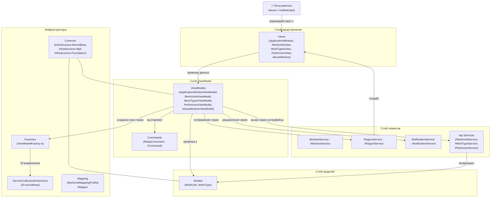
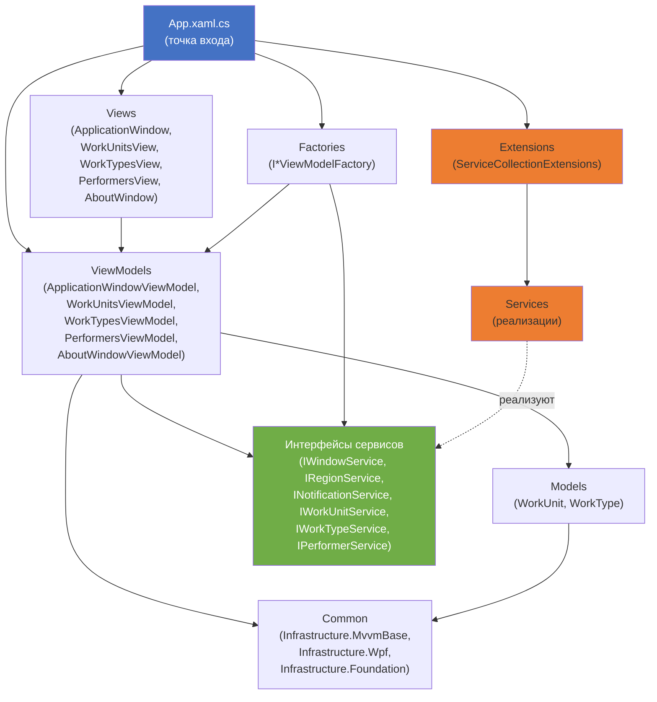
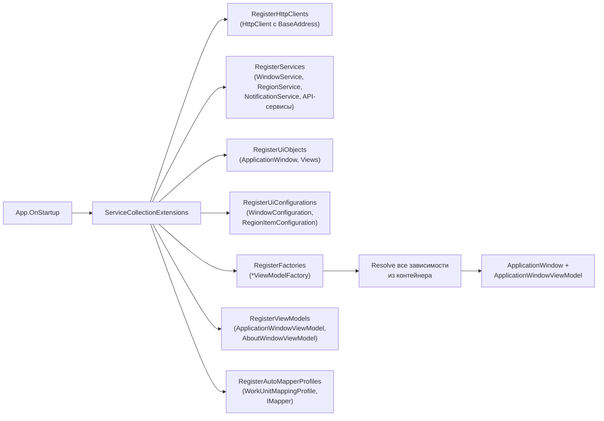

# RmWpfApp

WPF-приложение (**.NET Framework 4.8**, C#), построенное по паттерну **MVVM** с внедрением зависимостей через **Microsoft.Extensions.DependencyInjection**, для просмотра и управления **справочниками**: единицы работ, виды работ и исполнители договоров.

---

## Содержание

1. [Общая архитектура](#общая-архитектура)
2. [Структура проекта](#структура-проекта)
3. [Диаграмма зависимостей](#диаграмма-зависимостей)
4. [Диаграмма классов домена](#диаграмма-классов-домена)
5. [Внедрение зависимостей (Microsoft.Extensions.DependencyInjection)](#внедрение-зависимостей-microsoftextensionsdependencyinjection)
6. [Сборка и запуск](#сборка-и-запуск)

---

## Общая архитектура

Проект реализует паттерн **MVVM** (Model – View – ViewModel) поверх WPF. Views знают только о своих ViewModels; ViewModels работают с сервисами и моделями исключительно через **абстракции** (интерфейсы). Конкретные реализации связываются только в точке композиции — `App.OnStartup` совместно с `ServiceCollectionExtensions`.



**Ключевые принципы:**

| Принцип | Реализация |
|---|---|
| Разделение ответственности | `View` (только UI) / `ViewModel` (презентационная логика) / `Model` (данные) / `Service` (API и UI-обёртки) |
| Инверсия зависимостей | ViewModels зависят от `IWindowService`, `IRegionService`, `INotificationService`, `IWorkUnitService` и др. — не от реализаций |
| Composition Root | Все привязки «интерфейс → реализация» в `Extensions/ServiceCollectionExtensions.cs` |
| Тестируемость | ViewModels не содержат прямых вызовов UI-типов WPF, что позволяет покрывать их юнит-тестами с моками |
| Наблюдаемые привязки | `NotifyPropertyChangedBase`, `NotifyPropertyChangedValueStoreBase` и `LoadingViewModelBase` генерируют `PropertyChanged` для data binding |

---

## Структура проекта

```
RmWpfApp/
├── RM.App.sln               # Решение (1 проект)
├── README.md
└── RM.App/
    ├── Program.cs           # (через App.xaml / App.xaml.cs — точка входа)
    ├── App.xaml             # Ресурсы приложения
    ├── App.config           # Конфигурация (binding redirects, appSettings)
    ├── RM.App.csproj        # Проект (net48, WPF)
    ├── Extensions/
    │   └── ServiceCollectionExtensions.cs  # DI-регистрации
    ├── Factories/
    │   ├── IWorkUnitsViewModelFactory.cs
    │   ├── WorkUnitsViewModelFactory.cs
    │   ├── IWorkTypesViewModelFactory.cs
    │   ├── WorkTypesViewModelFactory.cs
    │   ├── IPerformersViewModelFactory.cs
    │   ├── PerformersViewModelFactory.cs
    │   ├── IAboutWindowViewModelFactory.cs
    │   └── AboutWindowViewModelFactory.cs
    ├── Mapping/
    │   └── Profiles/
    │       └── WorkUnitMappingProfile.cs  # AutoMapper
    ├── Models/
    │   ├── WorkUnit.cs
    │   └── WorkType.cs
    ├── ViewModels/
    │   ├── ApplicationWindowViewModel.cs
    │   ├── WorkUnitsViewModel.cs
    │   ├── WorkTypesViewModel.cs
    │   ├── PerformersViewModel.cs
    │   └── AboutWindowViewModel.cs
    ├── Views/
    │   ├── ApplicationWindow.xaml / .xaml.cs
    │   ├── AboutWindow.xaml / .xaml.cs
    │   ├── WorkUnitsView.xaml / .xaml.cs
    │   ├── WorkTypesView.xaml / .xaml.cs
    │   └── PerformersView.xaml / .xaml.cs
    └── Properties/          # AssemblyInfo, Resources, Settings
```

| Папка / Файл | Слой | Назначение |
|---|---|---|
| `App.xaml.cs` | Точка входа | Строит `IServiceCollection`, собирает `ServiceProvider`, создаёт главное окно и запускает приложение |
| `Views/` | View | WPF-окна и пользовательские элементы (`ApplicationWindow` — главное окно с Menu/ToolBar/TabControl, `WorkUnitsView`, `WorkTypesView`, `PerformersView` — UserControl для вкладок, `AboutWindow` — модальное окно «О программе») |
| `ViewModels/` | ViewModel | Презентационная логика (`ApplicationWindowViewModel`, `WorkUnitsViewModel`, `WorkTypesViewModel`, `PerformersViewModel`, `AboutWindowViewModel`), выставляют `RelayCommand` |
| `Models/` | Model | Доменные данные (`WorkUnit`: Id, Name; `WorkType`: Id, Name, WorkUnit) |
| `Factories/` | Инфраструктура | `I*ViewModelFactory` / `*ViewModelFactory` — создают ViewModels из DI-scope |
| `Extensions/` | Инфраструктура | `ServiceCollectionExtensions` — DI-регистрации (API-клиенты, сервисы, UI-объекты, конфигурации, ViewModel-фабрики, AutoMapper) |
| `Mapping/` | Инфраструктура | `WorkUnitMappingProfile` — AutoMapper-профиль для маппинга `WorkUnitResponse` → `WorkUnit` |

### Базовые классы (Infrastructure.MvvmBase)

| Класс | Назначение |
|---|---|
| `NotifyPropertyChangedBase` | Абстрактный базовый класс: реализует `INotifyPropertyChanged`, методы `GetValue<T>()` / `SetValue<T>(value)` |
| `NotifyPropertyChangedValueStoreBase` | Наследник `NotifyPropertyChangedBase`: поддерживает strongly-typed свойства с ключами (именами), методы `GetValue<T>(propertyName)` / `SetValue(value, propertyName)` |
| `LoadingViewModelBase` | Базовый класс ViewModel с свойством `IsLoading` (индикатор загрузки) |
| `RelayCommand` | `ICommand` с делегатами `execute`/`canExecute` |

---

## Диаграмма зависимостей

Направление стрелки означает «зависит от». ViewModels и Models зависят только от абстракций и `Common`; конкретные сервисы и DI-контейнер известны только `App.OnStartup` и `ServiceCollectionExtensions`.



---

## Диаграмма классов домена

Сквозной путь данных: `IWorkUnitService` / `IWorkTypeService` (API) → `WorkUnit` / `WorkType` → `WorkUnitsViewModel` / `WorkTypesViewModel` → привязка данных → `WorkUnitsView` / `WorkTypesView`. ViewModel не обращается к UI-типам WPF напрямую.

```mermaid
classDiagram
    direction TB

    class IWorkUnitService {
        <<interface>>
        +GetAllAsync() Task~IList~WorkUnitResponse~~
    }
    class IWorkTypeService {
        <<interface>>
        +GetAllAsync(PageOptionsRequest) Task~IList~WorkTypeResponse~~
    }
    class IPerformerService {
        <<interface>>
        +GetAllAsync() Task~IList~PerformerResponse~~
    }

    class INotificationService {
        <<interface>>
        +Show(message, title, icon)
    }
    class IWindowService {
        <<interface>>
        +Show(viewModel)
    }
    class IRegionService {
        <<interface>>
        +Show(viewModel)
        +CloseAll()
    }
    class IMapper~TIn, TOut~ {
        <<interface>>
        +Map(source) TOut
    }

    class NotifyPropertyChangedBase {
        <<abstract>>
        +GetValue~T~() T
        +SetValue~T~(value)
    }
    class NotifyPropertyChangedValueStoreBase {
        <<abstract>>
        +GetValue~T~(propertyName) T
        +SetValue~T~(value, propertyName)
    }
    class LoadingViewModelBase {
        <<abstract>>
        +IsLoading : bool
    }

    class WorkUnit {
        +Id : int
        +Name : string
    }
    class WorkType {
        +Id : Guid
        +Name : string
        +WorkUnit : WorkUnit
    }

    class ApplicationWindowViewModel {
        -_windowService : IWindowService
        -_regionService : IRegionService
        -_workUnitsViewModelFactory : IWorkUnitsViewModelFactory
        -_workTypesViewModelFactory : IWorkTypesViewModelFactory
        -_performersViewModelFactory : IPerformersViewModelFactory
        -_aboutWindowViewModelFactory : IAboutWindowViewModelFactory
        +WindowTitle : string
        +ShowAboutCommand : RelayCommand
        +ShowWorkUnitsCommand : RelayCommand
        +ShowWorkTypesCommand : RelayCommand
        +ShowPerformersCommand : RelayCommand
        +CloseRegionItemsCommand : RelayCommand
    }

    class WorkUnitsViewModel {
        -_workUnitService : IWorkUnitService
        -_workUnitMapper : IMapper~WorkUnitResponse, WorkUnit~
        -_notificationService : INotificationService
        +WorkUnits : ObservableCollection~WorkUnit~
        +ReloadWorkUnitsCommand : RelayCommand
        -ExecuteReloadWorkUnits(obj)
    }

    class WorkTypesViewModel {
        -_workTypeService : IWorkTypeService
        -_notificationService : INotificationService
        +WorkTypes : ObservableCollection~WorkType~
        +ReloadWorkTypesCommand : RelayCommand
        -ExecuteReloadWorkTypes(obj)
    }

    class PerformersViewModel {
    }

    class AboutWindowViewModel {
        +WindowTitle : string
    }

    class IWorkUnitsViewModelFactory {
        <<interface>>
        +Create() WorkUnitsViewModel
    }
    class WorkUnitsViewModelFactory {
        -_workUnitService : IWorkUnitService
        -_workUnitMapper : IMapper~WorkUnitResponse, WorkUnit~
        -_notificationService : INotificationService
        +Create() WorkUnitsViewModel
    }

    class IWorkTypesViewModelFactory {
        <<interface>>
        +Create() WorkTypesViewModel
    }
    class WorkTypesViewModelFactory {
        -_workTypeService : IWorkTypeService
        -_notificationService : INotificationService
        +Create() WorkTypesViewModel
    }

    class IPerformersViewModelFactory {
        <<interface>>
        +Create() PerformersViewModel
    }
    class PerformersViewModelFactory {
        +Create() PerformersViewModel
    }

    class IAboutWindowViewModelFactory {
        <<interface>>
        +Create() AboutWindowViewModel
    }
    class AboutWindowViewModelFactory {
        +Create() AboutWindowViewModel
    }

    class ApplicationWindow {
        <<Window>>
        +ContentTabs : TabControl
    }
    class WorkUnitsView {
        <<UserControl>>
        +OnLoaded()
    }
    class WorkTypesView {
        <<UserControl>>
        +OnLoaded()
    }
    class PerformersView {
        <<UserControl>>
    }
    class AboutWindow {
        <<Window>>
    }

    NotifyPropertyChangedBase <|-- NotifyPropertyChangedValueStoreBase
    NotifyPropertyChangedValueStoreBase <|-- WorkUnit
    NotifyPropertyChangedValueStoreBase <|-- WorkType
    NotifyPropertyChangedValueStoreBase <|-- AboutWindowViewModel
    NotifyPropertyChangedBase <|-- PerformersViewModel
    NotifyPropertyChangedBase <|-- ApplicationWindowViewModel
    LoadingViewModelBase <|-- WorkUnitsViewModel
    LoadingViewModelBase <|-- WorkTypesViewModel

    IWorkUnitService <|.. WorkUnitService
    IWorkTypeService <|.. WorkTypeService
    IPerformerService <|.. PerformerService
    INotificationService <|.. NotificationService
    IWindowService <|.. WindowService
    IRegionService <|.. RegionService
    IWorkUnitsViewModelFactory <|.. WorkUnitsViewModelFactory
    IWorkTypesViewModelFactory <|.. WorkTypesViewModelFactory
    IPerformersViewModelFactory <|.. PerformersViewModelFactory
    IAboutWindowViewModelFactory <|.. AboutWindowViewModelFactory

    WorkUnitsViewModelFactory --> WorkUnitService : внедряет
    WorkUnitsViewModelFactory --> IMapper : внедряет
    WorkUnitsViewModelFactory --> INotificationService : внедряет
    WorkTypesViewModelFactory --> IWorkTypeService : внедряет
    WorkTypesViewModelFactory --> INotificationService : внедряет

    WorkUnitsViewModel --> IWorkUnitService : зависит от
    WorkUnitsViewModel --> IMapper~WorkUnitResponse,WorkUnit~ : зависит от
    WorkUnitsViewModel --> INotificationService : зависит от
    WorkUnitsViewModel --> WorkUnit : ObservableCollection
    WorkTypesViewModel --> IWorkTypeService : зависит от
    WorkTypesViewModel --> INotificationService : зависит от
    WorkTypesViewModel --> WorkType : ObservableCollection
    ApplicationWindowViewModel --> IWindowService : зависит от
    ApplicationWindowViewModel --> IRegionService : зависит от
    ApplicationWindowViewModel --> IWorkUnitsViewModelFactory : зависит от
    ApplicationWindowViewModel --> IWorkTypesViewModelFactory : зависит от
    ApplicationWindowViewModel --> IPerformersViewModelFactory : зависит от
    ApplicationWindowViewModel --> IAboutWindowViewModelFactory : зависит от

    WorkUnitsView --> WorkUnitsViewModel : привязка данных
    WorkTypesView --> WorkTypesViewModel : привязка данных
    ApplicationWindow --> ApplicationWindowViewModel : привязка данных
    AboutWindow --> AboutWindowViewModel : привязка данных

    style IWorkUnitService fill:#70ad47,color:#fff
    style IWorkTypeService fill:#70ad47,color:#fff
    style IPerformerService fill:#70ad47,color:#fff
    style INotificationService fill:#70ad47,color:#fff
    style IWindowService fill:#70ad47,color:#fff
    style IRegionService fill:#70ad47,color:#fff
    style IWorkUnitsViewModelFactory fill:#70ad47,color:#fff
    style IWorkTypesViewModelFactory fill:#70ad47,color:#fff
    style IPerformersViewModelFactory fill:#70ad47,color:#fff
    style IAboutWindowViewModelFactory fill:#70ad47,color:#fff
    style WorkUnit fill:#ed7d31
    style WorkType fill:#ed7d31
    style ApplicationWindowViewModel fill:#ed7d31
    style WorkUnitsViewModel fill:#ed7d31
    style WorkTypesViewModel fill:#ed7d31
```



---

## Внедрение зависимостей (Microsoft.Extensions.DependencyInjection)

Контейнер строится при запуске приложения в `App.OnStartup()`. Сервисы регистрируются через методы-расширения `IServiceCollection` в `ServiceCollectionExtensions`.



### Регистрации (`ServiceCollectionExtensions.cs`)

| Метод | Регистрация | Lifetime |
|---|---|---|
| `RegisterHttpClients` | HttpClient `"RmWebApi"` с `BaseAddress` из `app.config` | Transient (через `AddHttpClient`) |
| `RegisterServices` | `IWorkTypeService → WorkTypeService`, `IWorkUnitService → WorkUnitService`, `IPerformerService → PerformerService`, `INotificationService → MessageBoxNotificationService`, `IWindowService → WindowService`, `IRegionService → RegionService` | Transient / Singleton |
| `RegisterUiObjects` | `ApplicationWindow`, `AboutWindow`, `WorkUnitsView`, `WorkTypesView`, `PerformersView` | Singleton / Transient |
| `RegisterUiConfigurations` | `Dictionary<Type, WindowConfiguration>`, `Dictionary<Type, RegionItemConfiguration>` | Singleton |
| `RegisterViewModels` | `ApplicationWindowViewModel`, `AboutWindowViewModel` | Singleton / Transient |
| `RegisterFactories` | `IWorkUnitsViewModelFactory → WorkUnitsViewModelFactory`, `IWorkTypesViewModelFactory → WorkTypesViewModelFactory`, `IPerformersViewModelFactory → PerformersViewModelFactory`, `IAboutWindowViewModelFactory → AboutWindowViewModelFactory` | Singleton |
| `RegisterAutoMapperProfiles` | `WorkUnitMappingProfile`, `IMapper<,> → Mapper<,>` | Singleton |

### Соглашение по добавлению нового ViewModel-модуля

1. Создать `ViewModel` (наследник `LoadingViewModelBase` или `NotifyPropertyChangedBase`) и `UserControl` (View).
2. Добавить метод `Create()` в интерфейс `I*ViewModelFactory` и реализацию `*ViewModelFactory`.
3. Зарегистрировать фабрику в `RegisterFactories()`.
4. Зарегистрировать ViewModel и View в `RegisterViewModels()` / `RegisterUiObjects()`.
5. Добавить `RegionItemConfiguration` в `RegisterUiConfigurations()` (для отображения во вкладках).
6. Добавить `RelayCommand` и пункт меню в `ApplicationWindowViewModel` и `ApplicationWindow.xaml`.

---

## Сборка и запуск

```bash
# Сборка (требуется .NET Framework 4.8 targeting pack / Visual Studio)
dotnet build RM.App.sln

# Запуск
dotnet run --project RM.App
```

Приложение открывает главное окно **«Рабочее место сотрудника»** (`ApplicationWindow`). Пункт меню **«Модули → Справочник единиц работ»**, **«Справочник видов работ»** или **«Справочник исполнителей»**, а также соответствующие кнопки на панели инструментов открывают справочники во вкладках `TabControl`. Выбор вкладки загружает данные из REST API (базовый URL задаётся в `app.config` как `RmWebApiBaseUrl`). Кнопка **«Закрыть»** закрывает все открытые вкладки. Пункт меню **«Справка → О программе»** открывает модальное окно «О программе».

### NuGet-пакеты

| Пакет | Версия | Назначение |
|---|---|---|
| `Infrastructure.Foundation` | 1.0.0 | Базовые утилиты (bindings, команды) |
| `Infrastructure.Mapping.AutoMapper` | 2.0.0 | Обёртка AutoMapper для DI |
| `Infrastructure.MvvmBase` | 1.0.0 | Базовые классы MVVM (NotifyPropertyChangedBase, LoadingViewModelBase, RelayCommand) |
| `Infrastructure.Wpf` | 1.1.0 | WPF-сервисы (IWindowService, IRegionService, INotificationService) |
| `RM.Api` | 2.0.1 | API-клиенты, DTO и сервисы |

---

## Известные особенности

- `WorkTypesViewModel` выполняет маппинг `WorkTypeResponse` → `WorkType` вручную (без AutoMapper), в то время как `WorkUnitsViewModel` использует `IMapper<WorkUnitResponse, WorkUnit>` из AutoMapper.
- `PerformersViewModel` и `AboutWindowViewModel` — заглушки: не содержат бизнес-логики и не зависят от API-сервисов.
- `PerformersViewModelFactory` и `AboutWindowViewModelFactory` не внедряют зависимости — просто создают `new`.
- Базовый URL API (`RmWebApiBaseUrl`) задаётся в `app.config` и жёстко привязан к `https://192.168.122.1:5001/`.
- `WorkUnitMappingProfile` зарегистрирован, но используется только для `WorkUnit`; для `WorkType` маппинг не настроен.
- Тестовый проект отсутствует.
- `WorkTypesView` и `WorkUnitsView` загружают данные автоматически при событии `Loaded` (`OnLoaded`).